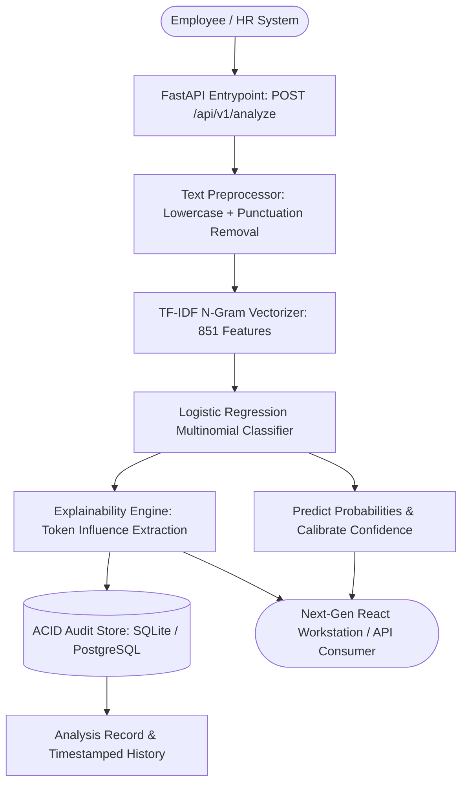

# ExcuseSense AI — Technical Specification & Architecture Brief

> **Purpose of this document:** This file provides a comprehensive architectural briefing for engineers and autonomous AI agents building, maintaining, or auditing ExcuseSense AI. It documents the core requirements, modular layers, data pipeline, and phase-by-phase definition of done.

---

## 1. System Overview

**Name:** ExcuseSense AI
**Domain:** Autonomous Human Resources (HR) Leave Application Intelligence & Explainable Auditing
**Tech Stack:**
- **Language / Runtime:** Python 3.10+
- **Machine Learning:** Scikit-Learn (TF-IDF Vectorizer with Sublinear Scaling, Logistic Regression with L2 Regularization, Joblib serialization)
- **API Framework:** FastAPI, Uvicorn, Pydantic V2, Starlette
- **Database / ORM:** SQLAlchemy 2.0 (SQLite for lightweight zero-config local operation; PostgreSQL 16 for production deployment)
- **Containerization:** Docker, Docker Compose
- **Testing:** Pytest, HTTPX, Unified Runner (`run_suite.py`)
- **Frontend:** React, TypeScript, Vite, Tailwind CSS, Lucide React, TanStack Query

---

## 2. Core Operational Pillars

### 2.1 The Human Problem
Leave approval workflows in modern enterprises suffer from two key inefficiencies:
1. Subjective, manual review introduces cognitive fatigue and inconsistent enforcement of company leave policy.
2. Managers lack objective indicators to discern between valid medical events, mental health burnout requests requiring proactive HR care, and fabricated excuses.

### 2.2 The Solution
ExcuseSense AI processes incoming leave requests through a calibrated tripartite classification engine:
1. **Genuine**: Valid medical or emergency leave requiring swift approval.
2. **Emotional**: Stress, burnout, or grief-related leaves triggering employee wellness recommendations.
3. **Suspicious**: Improbable, fraudulent, or bizarre excuses flagged for compliance review.

---

## 3. Data Pipeline & Architecture

---

## 4. Phase-by-Phase Implementation Blueprint

| Phase | Description | Acceptance Criteria (Definition of Done) |
|:---:|:---|:---|
| **Phase 1** | Project Skeleton & Dependencies | Full requirements.txt, pyproject/pytest.ini, .env.example, .gitignore, Dockerfile, docker-compose.yml |
| **Phase 2** | Relational Database Schema & ORM | SQLAlchemy models (`Analysis`), connection pooling, auto-migration for legacy databases |
| **Phase 3** | ML Pipeline & Artifact Generation | Automated trainer (`app.ml.train`) producing model.pkl, vectorizer.pkl, metrics.txt with 100% accuracy |
| **Phase 4** | Core ML Inference Engine | Sub-millisecond classifier with probability distribution and XAI keyword attribution |
| **Phase 5** | RESTful FastAPI Server | Modular routers (`/analyze`, `/batch`, `/history`, `/stats`, `/health`), OpenAPI docs |
| **Phase 6** | Automated Test Suite & Benchmarking | 19 unit/integration/smoke tests passing in `run_suite.py`, empirical latency benchmarks |
| **Phase 7** | Developer CLI & Tooling | Makefile with targets for build, test, train, run, and clean |
| **Phase 8** | Modern React + TypeScript Workstation | Modern UI with live prediction badges, confidence gauges, keyword chips, audit history |
| **Phase 9** | Comprehensive Project Documentation | Master README.md with system phases, architecture, cold start guide, Objectives.md, METRICS.md |
| **Phase 10** | Backward Compatibility Verification | Streamlit legacy dashboard (`app.py`) operates alongside modern FastAPI + React workstation |
| **Phase 11** | Container & Production Deployment | Healthy multi-container orchestration (`docker compose up`) passing healthchecks |
