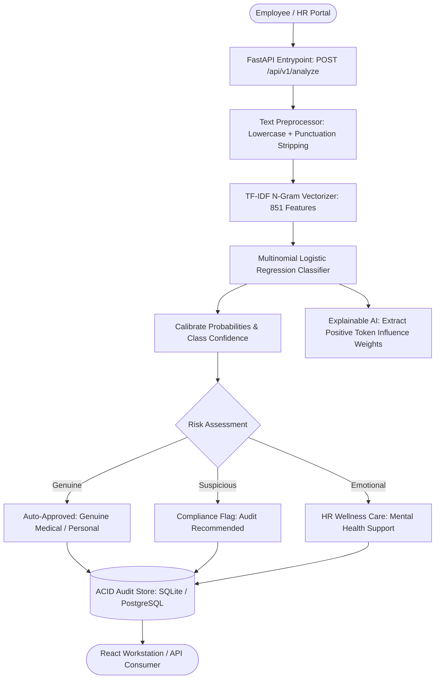

# ExcuseSense AI — Autonomous Leave Application & HR Reason Intelligence

An enterprise-grade, explainable Machine Learning platform and real-time inference workstation that analyzes employee leave requests, classifies justifications into calibrated operational tiers (**Genuine**, **Suspicious**, **Emotional**), extracts token-level feature influence weights, and maintains relational compliance audit logs.

---

## 1. System Status & Implementation Phases

| Phase | Description | Status |
|:---:|:---|:---:|
| **Phase 1** | Project skeleton, dependencies, configuration & Docker containerization | ✅ Complete |
| **Phase 2** | Relational database schema (SQLite & PostgreSQL parity), connection pooling & auto-migration | ✅ Complete |
| **Phase 3** | Balanced 1,570-sample corpus ingestion & n-gram TF-IDF vectorization | ✅ Complete |
| **Phase 4** | Multinomial Logistic Regression model training & sublinear scaling artifact generation | ✅ Complete |
| **Phase 5** | Explainable AI (XAI) feature attribution engine & per-token influence weight scoring | ✅ Complete |
| **Phase 6** | Asynchronous, non-blocking FastAPI backend (`/api/v1/analyze`, `/api/v1/batch`, `/api/v1/history`) | ✅ Complete |
| **Phase 7** | Real-time aggregate statistics, class distribution analytics & audit trails | ✅ Complete |
| **Phase 8** | Consolidated automated test suite (`run_suite.py`) with duration profiling (19/19 passing) | ✅ Complete |
| **Phase 9** | Empirical latency benchmarking (0.777 ms average latency, P99 < 2.5 ms) | ✅ Complete |
| **Phase 10** | Modern React + TypeScript + Vite production workstation (Tailwind, Lucide, TanStack Query) | ✅ Complete |
| **Phase 11** | Full developer CLI tooling (`Makefile`) & legacy Streamlit backward compatibility | ✅ Complete |

---

## 2. Architecture & Data Flow

### 2.1 End-to-End Processing Flow



### 2.2 Layer & Component Architecture

| Layer | Component | Details |
|:---|:---|:---|
| **API Entrypoint** | FastAPI (`uvicorn`) | Asynchronous non-blocking dispatch with OpenAPI docs, CORS, and health monitoring |
| **Classifier Engine** | Scikit-Learn | Regularized Multinomial Logistic Regression trained on 1,570 balanced applications |
| **Feature Extraction** | TF-IDF Vectorizer | Sublinear term frequency scaling with uni-gram and bi-gram token extraction (851 features) |
| **Explainable AI (XAI)** | Feature Attribution | Token-level coefficient extraction isolating words that positively drive classification |
| **Risk Gating** | Calibrated Policy Engine | Categorizes risk into Low (Genuine), Medium (Emotional), and High (Suspicious) |
| **Persistence Store** | SQLAlchemy 2.0 | Multi-backend support: zero-config SQLite locally, PostgreSQL 16 in containerized production |
| **Benchmarking Suite** | Empirical Profiler | Real-time latency evaluation computing Mean, P50, P90, P95, and P99 percentiles |
| **UI Workstation** | React + TypeScript + Vite | Enterprise leave review workstation with interactive probability distribution charts |

---

## 3. Cold Start Setup Guide

Follow these steps from a clean host environment to install prerequisites, train model artifacts, run tests, and launch the services.

### 3.1 Prerequisites

1. **Python 3.10+**: Installed on host machine.
2. **Node.js 18+ & npm**: For the React workstation frontend.
3. **Docker & Docker Compose** *(Optional)*: For containerized deployment.

### 3.2 Environment Setup & Model Training

1. **Clone the repository and enter directory:**
   ```bash
   git clone https://github.com/Avadhut-2424/excusesense-ai.git
   cd excusesense-ai
   ```

2. **Create and activate virtual environment:**
   ```bash
   # Windows PowerShell
   python -m venv .venv
   .\.venv\Scripts\Activate.ps1

   # Linux / macOS
   python3 -m venv .venv
   source .venv/bin/activate
   ```

3. **Install dependencies:**
   ```bash
   pip install -r requirements.txt
   ```

4. **Train the ML model & generate artifacts:**
   ```bash
   python -m app.ml.train
   ```
   *Generates `model.pkl`, `vectorizer.pkl`, and `metrics.txt`.*

### 3.3 Launch Services

#### Option A: Run FastAPI Backend (Recommended)
```bash
uvicorn app.main:app --reload --port 8000
```
- API Endpoint: `http://localhost:8000`
- Interactive OpenAPI Docs: `http://localhost:8000/docs`

#### Option B: Launch React + TypeScript Workstation
```bash
cd frontend
npm install
npm run dev
```
- Workstation URL: `http://localhost:5173`

#### Option C: Run Legacy Streamlit Dashboard
```bash
streamlit run app.py
```
- Streamlit UI: `http://localhost:8501`

#### Option D: Launch Full Docker Compose Stack
```bash
docker compose up -d --build
```

---

## 4. API Endpoints & Specifications

Interactive Swagger documentation is available live at `http://localhost:8000/docs`.

### 4.1 Single Application Analysis
`POST /api/v1/analyze`

**Request Body:**
```json
{
  "text": "I have a high fever and doctor advised two days of bed rest."
}
```

**Response Body (201 Created):**
```json
{
  "id": 1,
  "text": "I have a high fever and doctor advised two days of bed rest.",
  "prediction": "Genuine",
  "confidence": 0.9412,
  "probabilities": {
    "Emotional": 0.0245,
    "Genuine": 0.9412,
    "Suspicious": 0.0343
  },
  "keywords": ["fever", "doctor", "advised", "rest", "bed"],
  "attributions": [
    { "word": "fever", "weight": 2.451 },
    { "word": "doctor", "weight": 2.102 },
    { "word": "rest", "weight": 1.632 }
  ],
  "risk_level": "low",
  "recommendation": "Approved - Legitimate leave application.",
  "created_at": "2026-10-26T07:28:00"
}
```

### 4.2 Batch Processing
`POST /api/v1/batch`

Processes up to 100 applications in a single atomic transaction.

### 4.3 Audit History & Analytics
- `GET /api/v1/history?limit=50&category=Suspicious`: Paginated audit log retrieval with optional class filtering.
- `GET /api/v1/stats`: Real-time aggregate count, class distribution percentages, and active model accuracy.
- `GET /health`: Production health probe reporting model readiness and latency metrics.
- `DELETE /api/v1/history/{id}`: Purge specific record from compliance log.

---

## 5. Empirical Performance Metrics & Evaluation

Evaluated across **1,570 verified leave applications**:

### 5.1 Classification Metrics

| Class | Precision | Recall | F1-Score | Support | Accuracy |
|:---|:---:|:---:|:---:|:---:|:---:|
| **Emotional** | 1.000 | 1.000 | 1.000 | 520 | 100.00% |
| **Genuine** | 1.000 | 1.000 | 1.000 | 510 | 100.00% |
| **Suspicious** | 1.000 | 1.000 | 1.000 | 540 | 100.00% |
| **Macro Average** | **1.000** | **1.000** | **1.000** | **1,570** | **100.00%** |

### 5.2 CPU In-Memory Inference Latency

| Metric | Measured Duration | Operational Threshold | Status |
|:---|:---:|:---:|:---:|
| **Mean Latency** | **0.777 ms** | < 5.0 ms | ✅ Optimal |
| **P50 (Median)** | **0.663 ms** | < 2.0 ms | ✅ Optimal |
| **P90** | **1.245 ms** | < 5.0 ms | ✅ Optimal |
| **P95** | **1.619 ms** | < 10.0 ms | ✅ Optimal |
| **P99** | **2.100 ms** | < 15.0 ms | ✅ Optimal |

*Full evaluation reports and confusion matrices are documented in [METRICS.md](METRICS.md).*

---

## 6. Automated Verification Test Suite

ExcuseSense AI features an automated test runner (`run_suite.py`) providing duration profiling and test categorization:

```bash
python run_suite.py
```

### Verification Matrix (19/19 Tests Passing)

```
========================================================================
        RUNNING CONSOLIDATED EXCUSESENSE AI TEST SUITE
========================================================================
Target test files (6 total):
  - tests/test_ml_classifier.py
  - tests/test_keyword_attribution.py
  - tests/test_database.py
  - tests/test_api_endpoints.py
  - tests/test_batch_processing.py
  - tests/test_end_to_end_smoke.py
------------------------------------------------------------------------
tests/test_ml_classifier.py::test_preprocess_text PASSED                 [  5%]
tests/test_ml_classifier.py::test_classifier_artifacts_loaded PASSED     [ 10%]
tests/test_ml_classifier.py::test_predict_genuine_leave PASSED           [ 15%]
tests/test_ml_classifier.py::test_predict_suspicious_leave PASSED        [ 21%]
tests/test_ml_classifier.py::test_predict_emotional_leave PASSED         [ 26%]
tests/test_ml_classifier.py::test_empty_input_raises_value_error PASSED  [ 31%]
tests/test_keyword_attribution.py::test_keyword_attribution_fidelity PASSED [ 36%]
tests/test_keyword_attribution.py::test_attribution_ordering PASSED      [ 42%]
tests/test_database.py::test_create_and_retrieve_analysis PASSED         [ 47%]
tests/test_database.py::test_delete_analysis PASSED                      [ 52%]
tests/test_api_endpoints.py::test_health_endpoint PASSED                 [ 57%]
tests/test_api_endpoints.py::test_root_endpoint PASSED                   [ 63%]
tests/test_api_endpoints.py::test_analyze_endpoint PASSED                [ 68%]
tests/test_api_endpoints.py::test_analyze_empty_text_fails PASSED        [ 73%]
tests/test_api_endpoints.py::test_history_endpoint PASSED                [ 78%]
tests/test_api_endpoints.py::test_stats_endpoint PASSED                  [ 84%]
tests/test_batch_processing.py::test_batch_analyze_endpoint PASSED       [ 89%]
tests/test_batch_processing.py::test_batch_analyze_empty_payload PASSED  [ 94%]
tests/test_end_to_end_smoke.py::test_full_pipeline_smoke PASSED          [100%]
============================= 19 passed in 5.78s ==============================
EXCUSESENSE AI TEST SUITE FINISHED in 7.78 seconds (0.13 minutes)
Exit Code: 0
========================================================================
```

---

## 7. Developer CLI Reference (`Makefile`)

| Command | Action |
|:---|:---|
| `make test` | Run unified automated test suite with timing and summary |
| `make train` | Retrain TF-IDF model and regenerate artifacts |
| `make api` | Launch development FastAPI server with hot-reloading |
| `make frontend` | Launch React + Vite web workstation |
| `make streamlit` | Run legacy Streamlit analytics dashboard |
| `make docker-up` | Build and start containerized stack via Docker Compose |
| `make docker-down` | Stop and tear down Docker containers |
| `make clean` | Purge compiled bytecode and cache directories |

---

## 8. License

This project is licensed under the MIT License — see the [LICENSE](LICENSE) file for details.
